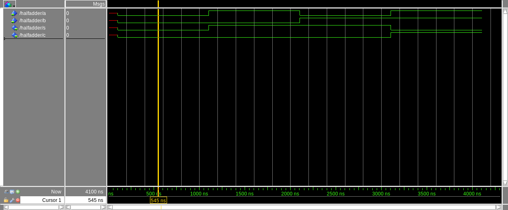
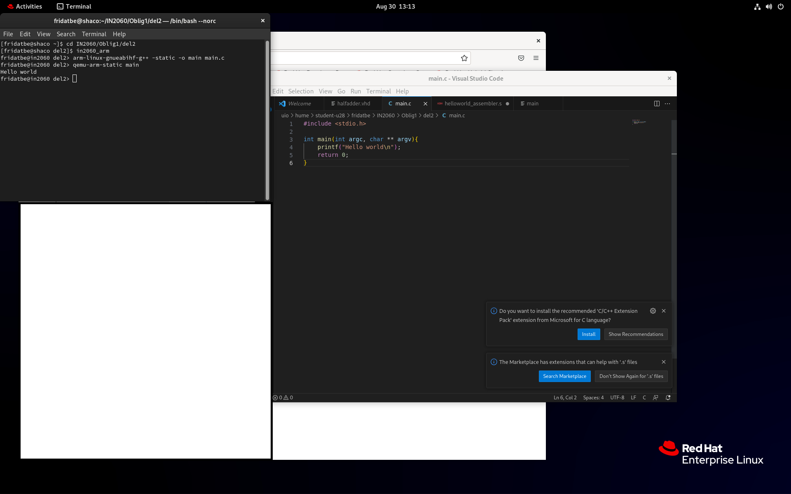
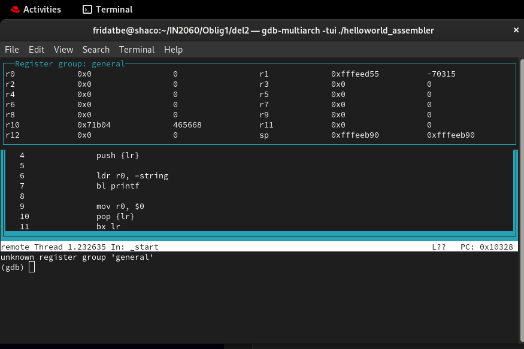
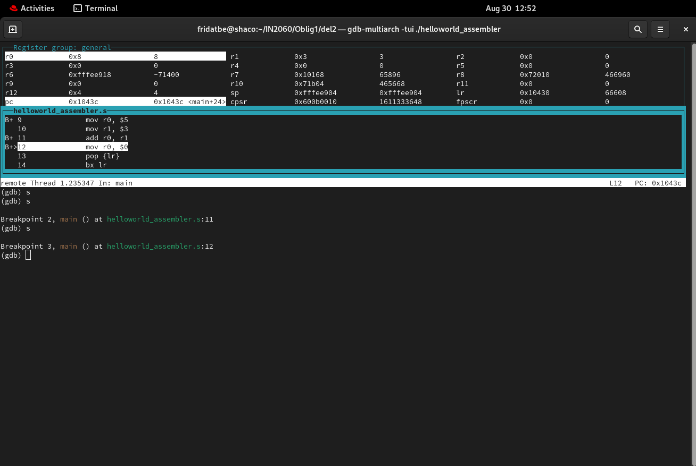

# Assignment 1 — Questa Simulation and ARM Assembly

An introduction to digital-design simulation, ARM cross-compilation, emulation and debugging.

This assignment was completed for **IN2060 — Digital Design and Computer Architecture** at the University of Oslo.

**Author:** Frida Berge (`fridatbe`)

## Overview

The assignment consists of two parts:

1. Compile and simulate a VHDL half-adder using Questa.
2. Compile and execute C and ARM assembly programs, then inspect register values using GDB.

The screenshots document the half-adder simulation, execution of a C program through QEMU and debugging of an ARM assembly program.

## Files

| File | Description |
| --- | --- |
| [taskdescription.pdf](./taskdescription.pdf) | Original assignment instructions |
| [halfadder.png](./halfadder.png) | Questa waveform showing all four half-adder input combinations |
| [helloworld_c.png](./helloworld_c.png) | C source, cross-compilation commands and program output |
| [helloworld_assembler.s](./helloworld_assembler.s) | ARM assembly source with the register-addition exercise |
| [gdb_tui.png](./gdb_tui.png) | GDB terminal interface showing assembly source and registers |
| [gdb_tui_add.png](./gdb_tui_add.png) | GDB capture showing the addition result in register `r0` |

The C and VHDL source files are not included in this folder. The C source is visible in `helloworld_c.png`, and the assignment brief provides the starter code for both exercises.

## Part 1 — Half-Adder Simulation

### Objective

Become familiar with compiling VHDL, applying input values and inspecting digital waveforms in Questa.

The half-adder has two inputs and two outputs:

| Signal | Role |
| --- | --- |
| `a` | First input bit |
| `b` | Second input bit |
| `s` | Sum output, calculated using XOR |
| `c` | Carry output, calculated using AND |

### Expected Behaviour

| `a` | `b` | `s` | `c` |
| --- | --- | --- | --- |
| 0 | 0 | 0 | 0 |
| 1 | 0 | 1 | 0 |
| 0 | 1 | 1 | 0 |
| 1 | 1 | 0 | 1 |

### Workflow

1. Enter the supplied half-adder code in `halfadder.vhd`.
2. Create a Questa project and add the source file.
3. Compile the design and correct syntax errors, including the missing semicolon in the starter code.
4. Start the simulation with signal visibility enabled.
5. Add `a`, `b`, `s` and `c` to the waveform window.
6. Force the inputs through all four combinations.
7. Check the outputs against the truth table and export the waveform.

### Simulation Result



The waveform shows the four input combinations and the expected sum and carry outputs.

The initial red section represents uninitialized signals before the inputs were assigned values. After initialization, the outputs follow the half-adder truth table.

## Part 2 — ARM Compilation and Debugging

### C Program

A small C program prints a greeting to the terminal.

The screenshot shows the program saved as `main.c`, cross-compiled for ARM and executed using QEMU on the course's Linux environment.

```bash
in2060_arm
arm-linux-gnueabihf-g++ -static -o main main.c
qemu-arm-static main
```



The terminal output confirms that the compiled program ran and printed `Hello world`.

The `in2060_arm` command is specific to the course environment; it is not a standard Linux command.

### ARM Assembly Program

The assembly exercise introduces:

- Loading a string address into a register.
- Calling `printf`.
- Saving and restoring the link register.
- Moving immediate values into registers.
- Adding register values.
- Inspecting execution with a debugger.

**Source:** [helloworld_assembler.s](./helloworld_assembler.s)

The initial program prints a greeting. The modified version also loads `5` into `r0` and `3` into `r1`, then adds them.

### Register Inspection



This capture shows the GDB terminal user interface with register values and the assembly source.

### Addition Result



The debugger is paused after the addition and before the following instruction resets `r0` to zero.

The screenshot shows:

| Register | Hexadecimal value | Decimal value |
| --- | --- | --- |
| `r0` | `0x8` | 8 |
| `r1` | `0x3` | 3 |

This confirms that the addition produced the expected result.

## Running the Included Assembly Code

### Requirements

- An ARM GNU cross-compiler providing `arm-linux-gnueabihf-g++`.
- QEMU providing `qemu-arm-static`.
- GDB providing `gdb-multiarch`.

The commands below follow the emulation workflow from the assignment. Installation and tool availability depend on the host environment.

### Compile and Execute

Run these commands from this folder:

```bash
arm-linux-gnueabihf-g++ -static -g \
  -o helloworld_assembler helloworld_assembler.s

qemu-arm-static ./helloworld_assembler
```

The `-static` flag creates a statically linked executable for the assignment's emulation setup. The compiler's `-g` flag includes debug information.

### Debug with GDB

Start QEMU with its GDB server listening on port `1234`:

```bash
qemu-arm-static -g 1234 ./helloworld_assembler &
```

Open GDB:

```bash
gdb-multiarch -tui ./helloworld_assembler
```

Connect and inspect the program:

```text
target remote localhost:1234
break main
continue
tui reg general
```

Useful GDB commands:

| Command | Purpose |
| --- | --- |
| `break main` | Set a breakpoint at `main` |
| `continue` | Resume execution |
| `stepi` | Execute one machine instruction |
| `info registers` | Print register values |
| `tui reg general` | Display general-purpose registers in the TUI |
| `quit` | Exit GDB |

Restart the QEMU command for each new debugging session.

## What I Learned

- How to compile and simulate a simple VHDL design.
- How to test combinational logic using manually assigned inputs.
- How to interpret waveforms and uninitialized signals.
- Why an ARM executable requires emulation when run on an x86 machine.
- How to cross-compile and execute ARM programs.
- How to inspect registers and step through assembly instructions using GDB.

## Scope and Attribution

This folder is an archive of an introductory tool exercise, not a complete hardware or processor project.

The assignment instructions and starter programs were provided by the course. The work involved following the tool setup, testing the half-adder, modifying the assembly program and recording the results.
